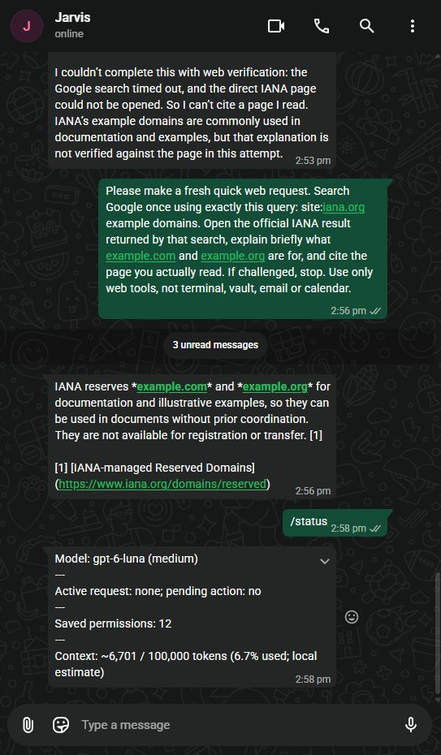

# Minimal Selenium experiment and deployment — 2026-10-17

The user authorized continuing through recommended steps until Google search
works. This record distinguishes experiment success from live search success.

## Current baseline

Revalidated over SSH before testing:

- Active release: `630811c7ff65868049fd0b1c1c9e05e91daabe93`.
- Service active, restart count zero, service user `jarvis-personal-runtime`.
- Chrome/ChromeDriver: `155.0.8059.39`; Python: `3.14.4`.

## Offline comparison

Diagnostic: [stealth_diagnostic.py](../live/stealth_diagnostic.py), copied to
`/home/samik/Projects/Jarvis/code/web-stealth-diagnostic.py` and run with `uv`
using the active installed runtime Python as the service user.

Both runs used a fresh temporary HOME/profile and a private Xvfb display.
The owned fixture was a data document, with HTTP(S) blocked and a dead loopback
proxy configured for background connections. No Google request was made in
these runs. This fixture-only driver does not modify the runtime network policy.

The candidate adds `--disable-blink-features=AutomationControlled` to headed
Chrome. Both comparison variants request a 1280x900 window. No UA/platform/GPU
spoofing, personal state, third-party stealth package, driver patch, or script
injection was introduced.

Observed:

| Measurement | Stock | Candidate |
| --- | --- | --- |
| `navigator.webdriver` | true | false |
| Platform | Linux x86_64 | Linux x86_64 |
| UA browser version | Chrome/155.0.0.0 | Chrome/155.0.0.0 |
| Languages | en-US, en | en-US, en |
| WebGL context | null | null |
| Namespace sandbox | Yes | Yes |
| Seccomp-BPF sandbox | Yes | Yes |
| Temporary directory removed | true | true |
| Remaining process-group members | none | none |

Client hints were absent on the data document, so this does not verify their
behavior on HTTPS. Window outer dimensions differed (stock 0x0, candidate
1279x899); this single capture is not sufficient to attribute that difference
to the flag rather than Xvfb/window initialization timing. Both inner dimensions
were 1279x756. Five PDF-viewer plugin entries were present in each.

This proves only that the intended automation signal changed with the sandbox
enabled. It does not prove Google acceptance or full integration invariants.
The candidate live probe uses the existing installed `SeleniumPageReader`, its
public-network proxy, script policy, parser and challenge handling unchanged.

## Live search and integration

Headless stock and headless with the flag encountered CAPTCHA. Headed Chrome
with the flag returned organic results without a CAPTCHA. This is an observed
result for these requests, not a guarantee against future challenges.

The returned Google HTML exposed two parser defects: organic results used opaque
`/goto?url=...` links, and an incidental non-modal dialog was treated as a block.
The parser now preserves the actual returned redirect URL instead of guessing a
destination from a truncated displayed URL. Reading it uses the normal page
allowance and public-network redirect validation, returning the final source URL.
CAPTCHA, consent and modal-dialog detection remain in place; unknown layouts
return `extraction_failed`.

Both a source probe and an installed-wheel probe returned `ok` with four results
for `site:iana.org example domains`. Reading the first result returned `ok`, real
IANA page text, and `https://www.iana.org/help/example-domains`. The quick budget
fell from zero queries/two pages after search to zero queries/one page after
reading. Request profiles were empty after close.

## Cleanup and verification

Native cancellation testing exposed an Xvfb authorization-directory leak. The
worker now puts Xauthority (mode 0600) and its display log inside its owned
profile, so normal and cancellation cleanup remove them together. Browser and
display processes remain in the supervised process group.

- Native Ubuntu suite before review follow-up: **509 passed in 129.33 seconds**, including real
  browser fixtures, headed/headless modes, normal completion and cancellation.
- Windows focused checks: 167 passed, one POSIX-only skip.
- Ruff checks, formatting and compileall passed.
- Web typechecking passed with `invalid-mutable-override` ignored. Without that
  exclusion, current ty reports the existing `_ProxyHandler.server` override;
  the same declaration was verified in the pre-change baseline.
- Pre-review staged release: `e64b59ac1f682242be0de7cf687c1ac31ca01ef6`.
  All twelve changed Git blobs match local implementation HEAD `0f577f7`.
  Hash-locked wheel installation and the service-account `--check` passed.

## Review follow-up

The combined independent Standards/Spec reviewer found that challenge-specific
non-modal dialogs could fall through as `extraction_failed`, allowing another
query in the same request. Four new regression cases reproduced the failure.
The fix recognizes challenge text in visible dialogs and source-free bodies,
preserving ordinary result prose and date/filter dialogs. It reaches the existing
blocked-request latch. A fifth regression verifies ordinary challenge-related
source prose remains usable. Focused parser/tool tests: 62 passed.

The reviewer also identified missing Xvfb prerequisite skips in the optional
installed-browser fixture. Headed cases now explicitly require xvfb-run/xauth.
The follow-up review of `0f577f7..5a8b7cd` reports **Standards: 0 findings;
Spec: 0 findings**. The originally configured separate review agents failed due
to backend/usage limits; a replacement reviewer assessed both axes. Linux ty
checking of the changed parser passed, retaining the baseline exclusion above.
The final native suite after these fixes passed **514 tests in 127.58 seconds**,
with real Chromium/ChromeDriver fixtures enabled and no skips.

## Production activation

Activated release `e69864c083a706ec7f4e8d5bfc8cb0cda46ae17e` after the final
suite and review. All twelve changed Git blobs match local `5a8b7cd`.
Installed wheel SHA256:
`083c01b095bea65a88e0ba4e4520e59d1216c22a437a01f53159babb72e437cb`.
Rollback release is `630811c7ff65868049fd0b1c1c9e05e91daabe93`.

Initial activation changed only `web_search.browser_mode` to `headed`; config
backup is `other/config/jarvis.before-headed.toml` (mode 0600). Service active,
restart count zero; OpenWA HTTP 200, exact named session ready. Prepared tools
are `load_skill`, `search_web`, and `read_web_pages`. Live prompt guidance
matches the packaged example. `SYSTEM.md` content remains unchanged, SHA256
`eb5ab2cd13457ba4a3b0db2a702c2bb9c7c1ce967e1a84e31335c1c684373247`.

The first WhatsApp request generated the query
`site:iana.org/domains/reserved example.com example.org example domains` and
hit the existing 20-second browser timeout. Jarvis disclosed the failure without
claiming it read a source. Cleanup left zero browser/display processes and zero
profiles. A separate installed service-user probe with a 60-second allowance
reached a Google challenge in 19.17 seconds and stopped. This demonstrates that
the minimal browser changes do not guarantee challenge-free Google access.

## Successful WhatsApp acceptance

The controlled request used the exact query `site:iana.org example domains`.
Live `operation_timeout_seconds` was increased to 60 with a separate validated
config backup, `other/config/jarvis.before-headed-timeout.toml` (mode 0600).
The count budgets remain unchanged. Final config SHA256:
`3c638aae8d216b145b8e41f73502137500c3ae65901270ee826237cf1ce07d4f`.

On 2026-10-17:

- 11:56:38 UTC: model called `search_web` with the exact query and quick depth.
- 11:56:57 UTC: search returned `ok` with four organic results, including
  “Example Domains” and “IANA-managed Reserved Domains”.
- 11:56:59 UTC: model called `read_web_pages` for
  `https://www.iana.org/domains/reserved`.
- 11:57:02 UTC: read returned `ok`, title “IANA-managed Reserved Domains”,
  `evidence_type=page`. Remaining budget: zero queries, one page, 28,431 evidence
  characters. The WhatsApp model selected a direct official URL; the earlier
  installed probe separately verified navigation through an opaque result link.
- Visible reply explained the domains' documentation/example purpose and
  registration restrictions with a numbered citation to the page actually read.
- Final `/status` at 14:58 Asia/Amman: no active request, no pending action,
  12 saved permissions, about 6,701/100,000 context tokens (local estimate).
- Final service active/running, zero automatic restarts, private listener
  `172.20.0.1:9011`, zero remaining browser/Xvfb processes or request profiles.

Only `load_skill(web)`, `search_web`, and `read_web_pages` were called during
acceptance. No terminal, vault, email or calendar tools were used by Jarvis.

This verifies deployed Google search, a real source read and a cited WhatsApp
answer. It does **not** establish reliable access for every query: another query
was challenged during this run. Future challenges still stop the request; no
CAPTCHA solving, personal cookies, proxy rotation or paid search service was
introduced. The added search-service spend remains $0.
