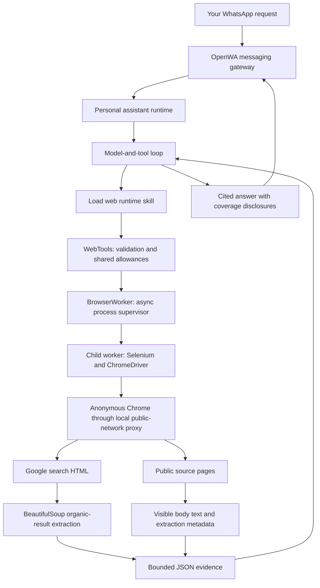
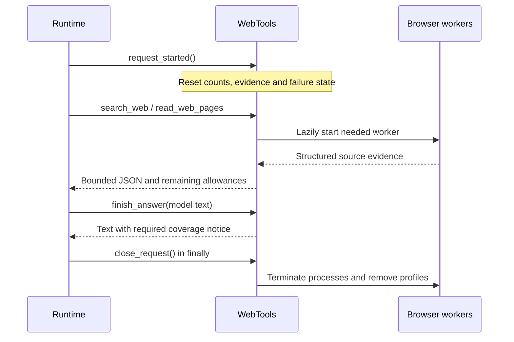

# How Jarvis web search works

Prepared on **26 October 2026**, updated **29 October 2026** for the web-search simplification.

Jarvis searches the public web by driving a real Chrome/Chromium browser with **Selenium**, opening Google's search page, parsing recognized organic result cards with **BeautifulSoup**, and optionally opening selected source pages to extract their visible text. The model chooses queries and sources and writes the answer; Python code controls browser access, validates destinations, enforces allowances, and returns structured evidence.

This document describes the working-tree source, including existing uncommitted web changes, at base commit `1a8421858032546dbf6bb865fdc789c68cb8f1d8`. That commit alone does not identify all the code described here. Historical deployment evidence is separated in section 16. The running server was not inspected for this documentation task.

## Contents

1. [The overall design](#1-the-overall-design)
2. [How the model gets access](#2-how-the-model-gets-access)
3. [The two tool interfaces](#3-the-two-tool-interfaces)
4. [What happens during a Google search](#4-what-happens-during-a-google-search)
5. [How Google results are extracted](#5-how-google-results-are-extracted)
6. [How source pages are read](#6-how-source-pages-are-read)
7. [Static and rendered reading](#7-static-and-rendered-reading)
8. [Chrome, ChromeDriver, Selenium, and Xvfb](#8-chrome-chromedriver-selenium-and-xvfb)
9. [The worker process and protocol](#9-the-worker-process-and-protocol)
10. [Public-network restrictions and privacy](#10-public-network-restrictions-and-privacy)
11. [Allowances and configuration](#11-allowances-and-configuration)
12. [Evidence metadata and output fitting](#12-evidence-metadata-and-output-fitting)
13. [Failures and final-answer disclosure](#13-failures-and-final-answer-disclosure)
14. [Request lifecycle and follow-ups](#14-request-lifecycle-and-follow-ups)
15. [Worked examples](#15-worked-examples)
16. [Recorded verification and deployment](#16-recorded-verification-and-deployment)
17. [Practical limitations and troubleshooting](#17-practical-limitations-and-troubleshooting)
18. [Source map](#18-source-map)

## 1. The overall design

The web feature is a group of two prepared tools: `search_web` and `read_web_pages`. It belongs to the personal assistant runtime. OpenWA remains the messaging gateway: it delivers your WhatsApp message and sends the resulting reply, but it does not search Google or decide which sources to use.



The implementation uses the normal public Google search website. It has no search API key, paid search provider, paid proxy service, or hosted model-search fallback in this path. It is also separate from Jarvis's Google Workspace connection used for Gmail, Drive, and Calendar.

The local proxy is a restriction mechanism running beside Chrome; it is not a commercial proxy or an IP-rotation service. Google and source websites still see traffic from the host's outbound connection. Browser automation therefore remains subject to Google's challenges and site-specific access behavior.

The search component adds no paid search-service dependency. The surrounding model-and-tool loop still uses the configured model, and running Chrome still uses the server's CPU, memory, and network.

## 2. How the model gets access

Web access is optional. When `web_search.enabled` is false, the web adapter exposes no web tool definitions. When enabled, the runtime constructs `WebTools` and places it behind the runtime skill registry.

The registry associates the `web` skill with `search_web` and `read_web_pages`. The model initially receives a short skill catalog and `load_skill`. Loading `web` adds its trusted instructions and makes its configured tools available for the working session. Loading the skill does not create a browser or reset allowances.

The packaged web instructions tell the model to:

- Search for explicit search requests, current information, verification, and source comparisons; stable questions usually need no search.
- Choose `quick` for a narrow lookup and `moderate` for a broader comparison.
- Prefer relevant primary sources and start with one or two useful page reads.
- Inspect what came back before choosing another source.
- Stop once the evidence is sufficient, even if allowance remains.
- Cite returned sources and distinguish snippets from pages actually read.

These are instructions guiding the model's judgment. Input validation, counters, destination restrictions, worker supervision, and output limits are implemented in Python. The tool does not independently decide whether a source is authoritative or whether the research is sufficient.

The model-and-tool loop executes tools sequentially. It does not launch parallel searches or page reads. A list passed to `read_web_pages` is also processed sequentially.

## 3. The two tool interfaces

### `search_web`

```json
{
  "query": "site:iana.org example domains",
  "depth": "quick"
}
```

| Argument | Meaning |
| --- | --- |
| `query` | One nonempty search string, at most 2,048 characters. |
| `depth` | `quick` or `moderate`; selects or upgrades the request's ceilings. |

The model does not supply a result count. `results_per_query` comes from configuration. The default is five.

The result is a JSON string with an `outcome`, the `query`, a `results` list, and `remaining` allowances. Each accepted result contains a title, URL, snippet, and `evidence_type: "search_result"`. Failure results may include a reason.

### `read_web_pages`

```json
{
  "urls": ["https://www.iana.org/help/example-domains"],
  "depth": "quick",
  "render_mode": "static",
  "wait_for_text": null
}
```

| Argument | Meaning |
| --- | --- |
| `urls` | Between one and five URLs per call; actual network work remains constrained by the remaining page allowance. |
| `depth` | `quick` or `moderate`, sharing the same request state as searches. |
| `render_mode` | `static` for the initial read; `rendered` for an eligible explicit follow-up. |
| `wait_for_text` | `null` for static reads; a nonempty expected visible string of at most 200 characters for rendered reads. |

The strict model-facing schema requires all four fields. The Python dispatcher also accepts omitted rendering fields as static defaults for compatible callers.

The result contains a `pages` list and remaining allowances. Each page preserves its requested URL and resulting URL so the model can distinguish a redirect from the original request. Every URL is validated before the batch starts. Source identities for the whole batch must fit in the output envelope before network work begins.

Listing five URLs does not reset the request allowance. With the default moderate allowance, only five page attempts are available across calls. Entries that cannot be attempted remain explicitly `unattempted` rather than disappearing from the result.

Neither tool lets the model execute arbitrary JavaScript, click arbitrary controls, submit forms, log in, or operate a general browser UI.

## 4. What happens during a Google search

1. `WebTools._search()` checks the argument shape, query length, and requested depth.
2. A moderate call upgrades the active request ceilings without resetting consumed counts.
3. The adapter checks whether Google was already blocked, the static worker failed, or the query/evidence allowance is exhausted. A stopped request makes no new search attempt.
4. It ensures the result envelope can fit, then increments the query-attempt counter before calling the browser.
5. `_get_browser()` obtains the request's static/search browser wrapper. Its worker and Chrome session start lazily on first use.
6. The child constructs a URL using `urlencode`: `https://www.google.com/search?q=...&num=...`.
7. Selenium navigates Chrome directly to that URL. It does not type into a Google search box, and this implementation does not paginate through result pages.
8. Search navigation temporarily permits page scripts, with Chrome's static-profile JavaScript exceptions restricted to the configured Google origins.
9. If Google sends the browser to `consent.google.com`, the code recognizes one specific optional-cookie control: a unique English “Reject all” button or submit input. It clicks only that control. An unknown consent screen returns `blocked`.
10. The final search location must be Google's `/search`. `/sorry/`, an enable-JavaScript interstitial, or another unexpected destination produces a specific blocking reason.
11. After the page passes access checks, the worker reads `driver.page_source` and passes the HTML to `extract_google_results()`.
12. The adapter validates returned source identities again, fits the evidence into the remaining allowances, and returns JSON to the model.

Google's `num` parameter is a request for a number of results, not a promise. The parser returns at most the configured number of recognized organic cards, and may return fewer.

Opening Google's search page consumes a **query attempt**, not a source-page attempt. Opening one of its results later consumes a page attempt.

## 5. How Google results are extracted

BeautifulSoup parses the browser's HTML using Python's `html.parser`. It does not generate summaries or search the internet itself.

The parser deliberately recognizes a small set of organic-result layouts:

```text
#search .g
#search .tF2Cxc
#main .Gx5Zad
```

Within a card, it looks for an `h3`, finds its associated anchor, validates the destination, and extracts a snippet from known classes such as `.VwiC3b`, `.IsZvec`, `.aCOpRe`, and `.s3v9rd`.

Before collecting results, it removes hidden nodes and known advertising or synthesized-panel containers, including top/bottom ads and selected knowledge-panel structures. This is conservative selector-based extraction, not a universal classifier capable of recognizing every future Google layout.

Titles are capped at 512 characters. Individual snippets are capped at 2,000 characters and share the parser's text allowance, which is supplied from `max_chars_per_page`. Duplicate destination URLs are removed within one search result list. There is no equivalent free deduplication of later page reads: repeated reads cost another attempt.

### Redirect handling

Ordinary Google `/url?q=...` or `/url?url=...` links are unwrapped to the actual destination and validated. Other ordinary source links are validated directly.

Opaque `/goto?url=...` links are preserved as returned. The tool does not guess the destination from Google's display text. A later page read follows the redirect through the same public-network controls and returns the final URL. That read uses the ordinary page allowance.

### Empty results, unknown layouts, and challenges

The parser distinguishes four important outcomes:

| Outcome | Interpretation |
| --- | --- |
| `ok` | At least one recognized organic source was extracted. |
| `no_results` | A recognized empty-result message appeared in a dedicated status container, without source headings. |
| `extraction_failed` | The HTML did not yield recognized results or a reliable empty-result state. |
| `blocked` | A recognized challenge, consent barrier, or blocking message was detected. |

Empty-result handling includes observed English and Arabic messages in specific containers such as `#topstuff` and the relevant `#botstuff` heading. A quoted search's “no exact matches” notice must not hide other results. A new Google layout must not be reported as a genuine empty search merely because the selectors found nothing.

The parser also limits input HTML to 2,000,000 characters. Larger HTML yields `extraction_failed`.

## 6. How source pages are read

The page reader obtains **visible body text**, not an article-specific extraction or a screenshot interpretation.

For an ordinary static read, the worker:

1. Validates the requested public HTTP(S) URL.
2. Starts Chrome if needed.
3. Disables page scripts and navigates to `about:blank` to clear the previous document.
4. Clears the proxy's per-navigation block observations.
5. Navigates to the requested URL.
6. Checks the final URL and whether the top-level destination was denied by the proxy.
7. Examines `document.contentType`; HTML and XHTML are supported, while non-HTML content is rejected. An empty reported content type is tolerated by this check.
8. Checks for visible CAPTCHA/challenge elements and narrowly recognized challenge interstitial text. Public text alongside a login widget is allowed; no credentials are entered.
9. Reads the title and `document.body.innerText`.
10. Returns the beginning of that text, bounded by `max_chars_per_page`, plus metadata describing the extraction.

Clearing the old document matters: Chrome can leave a previous page visible after refusing a download. Without the reset, the tool could mistakenly attribute the previous page's text to the new URL.

Selenium's own `execute_script` calls inspect the document even when ordinary page-script execution is disabled. Static mode therefore means that the page's scripts are disabled during source navigation, not that Jarvis avoids all programmatic DOM inspection.

`body.innerText` follows the rendered DOM's visible text semantics. It can include menus, navigation, banners, footers, and other surrounding material. There is no Readability-style article extraction, relevance ranking of paragraphs, or section continuation in the current implementation.

A URL fragment is retained for citation and anchor inspection. For `https://example.org/page#pricing`, the reader checks whether an element with ID or name `pricing` exists. It still extracts the body prefix. Finding the anchor does not prove that pricing content was included in the returned text.

## 7. Static and rendered reading

Some websites deliver useful content in their original HTML. Others deliver a shell and use JavaScript to fetch or construct the content. The tool handles the latter with an explicit second read.

```json
{
  "urls": ["https://quotes.toscrape.com/js/"],
  "depth": "quick",
  "render_mode": "rendered",
  "wait_for_text": "Albert Einstein"
}
```

That call is permitted only after an eligible static read of the same canonical URL in the current ordinary request. The adapter removes the fragment when matching prior static outcomes. Changing `#section` does not create a new eligibility identity.

The prior static outcome must be `ok` or `extraction_failed`. A blocked or unsupported URL is denied, and a static timeout or unavailable result does not qualify. This prevents rendered mode from becoming an automatic retry of denied access.

Rendered reads use a **separate anonymous worker and Chrome profile**. Page JavaScript is enabled there. Static and rendered browsers do not share cookies or local storage. The rendered worker cannot perform Google searches.

The readiness check polls visible body text roughly every 100 milliseconds for a case-insensitive substring match against `wait_for_text`. It does not wait for network idle. It does not scroll, click a tab, select a country, operate a calculator, or solve a challenge.

Its deadline is based on the operation timeout, with a small reserve for extraction. Navigation and startup work can consume time before the expected text is observed. After waiting, scripts are disabled, the final URL is revalidated, and normal content/access checks run again.

There are two different timeout situations:

- **Content wait expires:** the page may still return `outcome: "ok"` with a usable excerpt, `render_wait: "timeout"`, and a readiness gap. The requested string was not observed.
- **Navigation or the supervising operation times out:** the result can be `timeout` with no page evidence. An outer worker timeout also terminates that worker.

Even `render_wait: "matched"` does not guarantee that the matching text falls within the returned prefix. The wait examines visible body text, while extraction still returns only the first allowed characters. Evidence claims must be grounded in the actual returned text.

A rendered follow-up costs another page attempt and its returned text costs additional evidence characters. Under quick defaults, one static read plus one rendered read consumes both page attempts.

## 8. Chrome, ChromeDriver, Selenium, and Xvfb

| Component | Responsibility |
| --- | --- |
| Selenium | Python automation library used to navigate and inspect the browser. |
| ChromeDriver | WebDriver service translating Selenium commands into browser operations. |
| Chrome/Chromium | Loads pages, runs permitted scripts, builds the DOM, and exposes visible text. |
| BeautifulSoup | Parses Google's result HTML after Chrome loads it. |
| Chrome DevTools Protocol (CDP) | Applies script, network-scheme, and download restrictions. |
| Xvfb | Provides a private virtual display for headed Chrome on the native Linux path. |

The dependency file currently pins `selenium==4.50.0` and `beautifulsoup4==4.15.0`. Browser and driver executables are located explicitly by the worker. Missing executables or required CDP controls produce an unavailable result; this path does not rely on an automatic browser/driver download to repair startup.

`browser_mode` is independent of `render_mode`:

| Setting | What it controls |
| --- | --- |
| `headless` | Runs Chrome with `--headless=new`, without a display. |
| `headed` | Runs normal Chrome under a private Xvfb display, with a 1280×900 window. |
| `static` | Disables page JavaScript for source reading. |
| `rendered` | Allows scripts in the separate rendering browser and waits for specified visible text. |

Both headed and headless browsers can perform static or rendered reads. The headed implementation requires POSIX and `xvfb-run`; it is not a visible personal browser window on the Windows development machine.

Headed mode adds `--disable-blink-features=AutomationControlled`. That changes one automation-related browser behavior. It does not establish anonymity or guarantee that Google will accept the traffic. The runtime stops at challenges rather than solving them.

Chrome starts with a fresh `--user-data-dir`, the local restrictive proxy, sandboxing enabled, and disabled extensions, sync, background networking, component updates, QUIC, and DNS prefetch. Password saving and autofill are disabled. Download denial is installed through CDP; startup fails if the required download restriction cannot be established.

## 9. The worker process and protocol

Selenium's API is synchronous and can block. Jarvis therefore places it in a child process instead of running those calls directly inside the runtime's asynchronous event loop.

`BrowserWorker` supervises a child launched through the current Python executable:

```text
python -m jarvis_personal_runtime.web_worker
    --profile-dir <request-owned directory>
    --timeout <operation timeout>
    --max-chars <per-page limit>
```

This is the runtime's internal process invocation. Developer commands in this Python repository should use `uv run`.

The parent and child communicate using one JSON object per line over stdin/stdout. For example, the internal search payload is:

```json
{"op":"search","query":"site:iana.org example domains","limit":5}
```

An internal page-read payload contains `op: "read"`, the URL, and the optional expected text. The protocol is deliberately narrow; the model is not given access to this transport or arbitrary driver methods.

An I/O lock serializes access to each worker. The parent checks response framing, JSON shape, response size, outcomes, and page fields. The explicit maximum protocol response size is 1,048,576 bytes; configured stream buffering can impose a smaller bound. The model ultimately receives a separately bounded JSON tool result.

Timeouts, cancellation, malformed transport, or a failed worker trigger supervised teardown. A dead worker is not silently restarted on the next tool call in that request. The static and rendered paths maintain separate failure state.

## 10. Public-network restrictions and privacy

The web tool is designed for public HTML. Several layers enforce that boundary.

### URL validation

`validate_public_url()` accepts only HTTP and HTTPS, rejects embedded usernames/passwords, malformed URLs, controls, backslashes, invalid ports, and excessive URL length, and canonicalizes the scheme and hostname.

Private, loopback, link-local, multicast, reserved, and unspecified IP addresses are rejected. IPv4-mapped IPv6 addresses are checked through their underlying IPv4 address. Numeric and abbreviated address spellings receive additional checks.

DNS names must be qualified. Local/internal suffixes such as `.localhost`, `.local`, `.internal`, `.intranet`, and `.home.arpa` are rejected. Internationalized domain names are normalized using IDNA.

### DNS and connection validation

An apparently public hostname can resolve to a private address. Checking only its spelling would be insufficient.

Chrome therefore sends network traffic through `PublicNetworkProxy`, a local HTTP proxy. Before opening a destination connection, the proxy resolves the host and rejects the **whole DNS answer** if any returned address is non-public. It then connects to a validated literal address, preventing a second hostname lookup from substituting a different destination between validation and connection.

HTTP requests are forwarded through this boundary; HTTPS uses a validated CONNECT tunnel. The proxy is not decrypting HTTPS page content. Chrome still handles TLS and page rendering.

Redirects and HTTP(S) subresources also encounter this connection boundary. Chrome's loopback proxy bypass is explicitly disabled. CDP additionally blocks schemes including `file:`, `filesystem:`, `data:`, `blob:`, `ftp:`, `ws:`, and `wss:`.

A blocked background request does not automatically discard a successfully loaded public document. The worker distinguishes recorded background denials from top-level navigation failure and validates the final destination before returning evidence.

### Anonymous state and untrusted evidence

Each worker gets a fresh `.jarvis-web-*` directory, a private browser profile, and an anonymous home directory. Its environment is constructed from a small allowlist rather than copied from the runtime's environment. It excludes inherited OpenAI/OpenWA/cloud credentials and personal browser state.

It does not use OpenWA's WhatsApp profile or the Google Workspace connection. This is session and credential isolation, not network anonymity: search queries and requested URLs still reach the relevant public services.

The packaged instructions treat titles, snippets, page text, and URLs as untrusted evidence. They cannot authorize another tool, approve an action, or ask Jarvis to disclose private data. The model is instructed to send only the search question and minimum relevant context, and to require explicit operator intent before sending private vault, email, or calendar content.

Those privacy instructions guide query construction; the web adapter is not a semantic data-loss-prevention filter that can recognize every secret inside an otherwise valid query.

## 11. Allowances and configuration

These are the current **code defaults**, also reflected in the example configuration. Explicit deployed TOML values override them.

| Setting | Default | Effect |
| --- | ---: | --- |
| `enabled` | `false` | Makes web tools available only when enabled. |
| `browser_mode` | `headless` | Selects Chrome display mode. |
| `operation_timeout_seconds` | 20 | Bounds worker operations and browser waits; not a total research stopwatch. |
| `results_per_query` | 5 | Maximum requested/extracted organic sources per query. |
| `max_chars_per_page` | 8,000 | Maximum page-text prefix; also supplied as the search parser's snippet-text allowance. |
| `max_total_evidence_chars` | 48,000 | Shared evidence-text allowance for the ordinary request. |
| `quick.max_queries` | 1 | Quick search attempts. |
| `quick.max_pages` | 2 | Quick source-page attempts. |
| `moderate.max_queries` | 3 | Moderate search attempts. |
| `moderate.max_pages` | 5 | Moderate source-page attempts. |

The example runtime configuration separately uses `max_output_chars = 65536`, `max_tool_rounds = 8`, and `request_timeout_seconds = 600`. Those are model-loop constraints, not additional web allowances. A request can stop because of an outer runtime limit before it spends all of its web allowance.

### Count-based research

Quick and moderate are ceilings on query and page counts. They are not “research for 30 seconds” and “research for two minutes.” Individual operations and the overall runtime request still have timeouts for bounded execution.

The counters belong to one ordinary request, not to each tool call. A search, direct URL read, rendered follow-up, and multi-URL batch all draw from the same state.

An attempted search or page read is charged before browser work, so failures also consume attempts. Duplicate reads are not free. Calls rejected before an attempt—for example invalid input, an already-denied URL, or an exhausted allowance—do not start another network operation.

### Upgrading depth

The request starts with quick limits. Any valid moderate call upgrades the ceilings for the rest of the request. It does not reset usage. Subsequent quick calls cannot downgrade or replenish them.

For example, after one quick search and one page read:

| State | Queries left | Page attempts left |
| --- | ---: | ---: |
| Still quick | 0 | 1 |
| After upgrading to moderate, before another attempt | 2 | 4 |

The evidence allowance is shared regardless of depth. Increasing depth does not restore already-returned text capacity.

### What counts as evidence characters

- For search results, accepted titles plus returned snippet characters are charged.
- For page reads, returned page-text characters are charged after final output fitting.
- URLs, JSON punctuation, and most metadata occupy serialized output capacity but are not charged as evidence text. Page titles are not charged by the page-text counter.

This is a character count, not a token count or a network-byte limit. Chrome can load more data than the evidence returned to the model.

The 48,000-character default allows five full 8,000-character page excerpts with some room for search evidence. Multiple searches and rendered rereads can consume the shared allowance sooner. Always use the returned `remaining` values rather than assuming that every configured attempt remains usable.

## 12. Evidence metadata and output fitting

The page result carries both access status and extraction facts:

| Field | Meaning and how to interpret it |
| --- | --- |
| `requested_url` | The URL supplied for that batch entry. |
| `url` | The resulting source URL, after redirects when available. |
| `title` | The page title, bounded by the implementation. |
| `text` | The actual excerpt returned for the model to use. |
| `evidence_type` | `page` for a page read; search items use `search_result`. |
| `outcome` | Access/extraction result for this page. |
| `source_chars` | Full visible body-text length observed at extraction, if known. |
| `truncated` | The returned text is shorter than the observed source or was explicitly clipped. |
| `more_content_available` | Mirrors the truncation fact; it does not promise a continuation API. |
| `extraction_method` | Currently `body_prefix`. |
| `section_found` | Whether the requested fragment's ID/name exists, or `null` when not applicable/known. |
| `render_mode` | `static` or `rendered`. |
| `render_wait` | `not_requested`, `matched`, or `timeout`. |
| `stop_reason` | A specific extraction or capacity limit, where applicable. |

The helper in `web_evidence.py` normalizes these facts as results cross process and tool boundaries. It does not infer that a section was read merely because its anchor exists.

Four distinct restrictions can shorten or limit evidence:

| Reason | Meaning |
| --- | --- |
| `page_text_limit` | The document is longer than the per-page prefix allowance. |
| `evidence_limit` | The shared request allowance restricted text or prevented further web work. |
| `output_limit` | The serialized JSON result could not accommodate all the evidence. |
| `render_wait_timeout` | The expected dynamic text did not appear within the wait. |

`page_limit` and `query_limit` separately explain why additional operations cannot start.

The JSON output cap matters because escaping and metadata consume space too. `_json_prefix()` fits text by each character's escaped JSON cost. `_fit_text()` reserves metadata once and distributes remaining space across excerpts, preserving source identities and complete small excerpts. Clipped excerpts carry output-limit metadata. If metadata alone cannot fit, the adapter returns a bounded limit result instead of silently cutting a URL into a different identity.

For batches, fitting reserves entries for unread sources, revisits the final envelope after stop reasons are added, and charges the text actually returned. Search fitting similarly keeps accepted source identities intact and may omit later sources when the remaining capacity is insufficient.

An `ok` result means the operation produced usable evidence. It does not mean that the whole document was returned, that a requested price appeared, or that every relevant source was checked.

## 13. Failures and final-answer disclosure

| Outcome | Typical meaning |
| --- | --- |
| `ok` | Usable result or page excerpt was returned. |
| `partial` | A result set or batch has usable evidence alongside missing, failed, or unattempted coverage. Inspect individual entries. |
| `no_results` | Google showed a recognized genuine empty-result state. |
| `blocked` | A URL/network restriction or recognized site/search challenge prevented access. |
| `unsupported` | Non-HTML content, authentication-related content, or another unsupported navigation. |
| `extraction_failed` | Access did not yield usable text or a recognized Google result layout. |
| `unavailable` | Browser startup, process, transport, or another availability failure. |
| `timeout` | Page navigation or a browser operation exceeded its bound. |
| `limit_reached` | A configured allowance or output capacity prevented useful additional work. |
| `unattempted` | A particular batch URL was not read. Its reason explains why. |
| `invalid_input` | Tool arguments did not satisfy the interface or rendered-read prerequisites. |

Not every outcome appears identically at every layer. In particular, `_search()` converts a worker search timeout to a public `unavailable` outcome while retaining the original timeout in request failure state for final disclosure. Page reads can preserve `timeout` directly.

### Blocking stops further Google searches

When a search returns `blocked`, the recorded search failure stops further searches for the remainder of the ordinary request. Additional search calls return a blocking result without making another Google request. The model is instructed not to solve challenges, silently retry, or wait for human challenge completion.

A Google search block does not automatically prohibit appropriate known public source URLs. Direct page reading can still work if its browser remains usable and page allowance remains. A dead static/search worker is a different condition and prevents further operations through that worker.

Blocked or unsupported page URLs are also remembered for the request using their fragment-free canonical identity. Changing a fragment does not bypass that denial.

### Disclosure has a code-enforced part

After the model drafts its answer, `WebTools.finish_answer()` can prepend factual disclosures based on recorded state. These include blocked/timed-out search, page access outcomes, the number of successful excerpts, allowance exhaustion, and dynamic-content wait failures.

If access failed and no usable evidence exists, the notice states that current web evidence could not be verified and that any answer below uses existing knowledge. If some evidence exists, the adapter can state that coverage is incomplete. A genuine empty search without evidence receives an empty-results notice rather than an outage claim.

This mechanism helps prevent the final answer from hiding a failed operation. It does not automatically verify every sentence or generate all citations. The model still has to connect claims to the returned evidence, explain important gaps, and disclose relevant per-page truncation.

Search failure history is conservative. Page failures are keyed by canonical URL and cleared by a successful reread of that URL; resolved page failures no longer produce a stale access-failure notice. Static and rendered worker availability remain separate.

## 14. Request lifecycle and follow-ups

An **ordinary request** is one admitted message entering the model-and-tool loop. A **working session** is the longer-lived in-memory conversation that can contain several requests.



The model loop closes browser resources in a `finally` path on completion, failure, timeout, cancellation, and suspension for an approval. If a different tool requires approval, the browser closes while the consumed web counters remain attached to that suspended ordinary request. Resuming the approval does not call the fresh-request reset hook.

The web tools themselves have no approval continuation. `WebTools.resume()` rejects such a continuation; approval lifecycle support is relevant because a request can use several tool groups.

On native POSIX execution, workers start in a new process group. Cleanup signals that group, waits briefly, and escalates to killing the group so ChromeDriver, Chrome, and Xvfb descendants can be removed even if the leader exited. Cleanup is shielded from cancellation so cancellation does not immediately abandon teardown.

Profiles, anonymous homes, Xvfb authorization, and display logs live under the request-owned directory. Removing it removes this temporary state. The implementation attempts cleanup, but suppressed filesystem-removal errors mean production cleanup should still be verified operationally when diagnosing leaks.

A follow-up ordinary request gets new counters and fresh browser state. It can reuse source evidence still present in the working-session transcript without fetching again. There is no separate persistent search cache.

Explicit rechecks and time-sensitive claims should trigger fresh tool calls. `/new`, inactivity expiry, context reset, and restart end evidence retention and loaded-skill state. A new browser does not imply that prior transcript evidence disappeared; a new working session does.

## 15. Worked examples

### A narrow factual lookup

You ask: “Search for what IANA says example.com is used for.”

The model loads `web`, searches once at quick depth, then reads the most relevant IANA page if the snippet alone is insufficient. After one search and one successful page attempt, it has zero quick queries and one page attempt remaining. It answers with a numbered citation to the returned IANA source. It need not spend the last page attempt if the question is already answered.

### A comparison across sources

You ask for a comparison that needs multiple official sources. The model selects moderate depth, makes a focused query, reads one or two sources, inspects gaps, and chooses the next query or page accordingly. All searches share the three-query ceiling, all reads share the five-page ceiling, and both share the 48,000-character default evidence allowance.

The tool does not implement a hidden autonomous research planner. The model selects the sequence; code enforces the bounds.

### A JavaScript-loaded page

The first static read returns the page shell. The model notices that the needed content is missing and makes an explicit rendered read of the same URL with a specific expected label. The second browser runs the scripts and waits for that label.

If the label appears, the result records `render_wait: "matched"`. If the wait ends first, the answer must not claim that label or value was observed. A useful excerpt can still support other claims. Both reads consume page attempts.

### A long pricing page

The browser successfully loads a pricing page with 40,000 visible characters, but the per-page cap returns only the first 8,000. The metadata reports truncation and `body_prefix` extraction. A requested anchor may exist later in the DOM.

If the needed price is absent from the returned excerpt, the justified conclusion is “this read did not verify that price.” It is not “the website does not publish that price.” Repeating the same static URL with a different fragment does not provide section continuation.

### Google challenges the request

The query attempt is consumed, the search returns `blocked`, and further Google searches stop for that request. The model may read an appropriate known direct source if the worker and allowances permit. The final answer distinguishes failed Google search from successful direct-page evidence and leaves unsupported current claims unverified.

## 16. Recorded verification and deployment

The following facts come from the repository's [deployment verification record](../.scratch/web-evidence-quality/deployment-verification.md), read while preparing this document. They are historical results, not a live check performed on 26 October.

The record identifies release `9520982fd6fc6f780dfe975b4a6bbe61789b7ff7`, deployed on 24 October 2026 and checked again on 25 October. Its recorded settings were enabled web access, **headed Chrome**, a **60-second operation timeout**, five results per query, 8,000 characters per page, 48,000 total evidence characters, and the same quick/moderate count ceilings described above.

This explains why the recorded server behavior differs from the example defaults of disabled access, headless Chrome, and a 20-second timeout.

| Recorded check | Evidence and practical meaning |
| --- | --- |
| Exact deployed-source test suite | 570 tests passed, including real headed/headless browser coverage; the record also reports lint, formatting, compilation, package integrity, and service-account checks. |
| Static-to-rendered JavaScript page | Static read returned 78 characters without quotes; rendered read waiting for `Albert Einstein` returned 1,499 characters with the expected content. The WhatsApp reply correctly quoted and cited it. |
| Five-page research | Returned 35,720 characters across five successful reads; the reply distinguished truncated excerpts and reported the page limit. |
| Google plus IANA | One query returned four organic results, then an IANA page read succeeded and the reply distinguished search evidence from page verification. |
| Cloud pricing | Two static reads returned truncated 8,000-character excerpts. A rendered wait for `e2-standard-2` timed out; the reply left the specific E2 price/region unverified. This was a failure-reporting check, not successful extraction of that price. |
| Final operational check | The record reports the service running with zero restarts, the named gateway session ready, no remaining browser workers/profiles, and an idle WhatsApp `/status`. |

The [earlier implementation verification record](../.scratch/web-evidence-quality/verification.md) describes an earlier 559-test isolated-source run and explicitly says production deployment had not yet occurred at that stage. The later deployment record supersedes that pending deployment status; the two test counts describe different verified source snapshots.

The local checkout and deployed source were not identical. The deployment record says production had newer assistant/terminal behavior and that scoped web changes were applied on top of that deployed base. Do not infer the current production version solely from local Git HEAD or these historical records.

## 17. Practical limitations and troubleshooting

The implementation is useful for bounded public research, but its current extraction scope is specific:

- It depends on recognized Google HTML layouts. A layout change can cause `extraction_failed` even when a person sees search results.
- It can encounter Google CAPTCHA, consent, or traffic blocks. Headed mode does not eliminate them, and the tool does not infer an IP-reputation cause without diagnostic evidence.
- It reads a visible body prefix. It does not retrieve arbitrary sections, continue at an offset, or automatically extract the most relevant paragraph.
- It can wait for dynamic text, but cannot operate region selectors, tabs, calculators, login flows, or other interactive controls.
- Challenge detection is heuristic. Static extraction and rendered waiting share the same narrow checks: visible CAPTCHA elements, exact challenge titles, or a recognized opening line in a short interstitial. Long articles and ordinary prose discussing access errors are readable, as is anonymous public text alongside a password field.
- PDFs, downloads, authenticated pages, and general browser automation are outside the prepared tool's scope.
- Repeated reads consume allowances, and output capacity can truncate evidence before the total evidence ceiling is reached.
- Citation quality, source selection, and semantic correctness still require the model to use the evidence carefully.

For an observed problem, inspect the structured result before assigning a cause:

| Symptom | First evidence to inspect |
| --- | --- |
| No web tools available | `web_search.enabled`, runtime adapter construction, and whether the `web` skill is loaded. |
| Browser cannot start | Returned availability reason, installed Chrome/Chromium and ChromeDriver, executable access for the service account, and required CDP controls. |
| Headed startup fails | POSIX environment, `xvfb-run`/`xauth`, and display setup. |
| Google returns no usable sources | Distinguish `no_results`, `extraction_failed`, and `blocked`; inspect the exact reason rather than calling all three “no results.” |
| Page loaded but needed fact is missing | `text`, `source_chars`, `truncated`, `extraction_method`, and `section_found`. |
| Dynamic content remains missing | Prior static eligibility, expected text, `render_wait`, operation timeout, and whether interaction would be required. |
| Later reads stop | `remaining`, per-entry `reason`, `stop_reason`, prior access denial, and worker availability. |
| Reply says coverage is incomplete | Earlier search/page failures, successful excerpt count, and allowance/readiness notices. |
| Processes remain after completion | Worker process-group teardown and `.jarvis-web-*` directories; historical cleanup success is not evidence for the current request. |

The runtime trace records tool calls and results and is useful for correlating these states. Those traces can contain sensitive verbatim queries and page content; treat their contents accordingly when sharing diagnostics.

## 18. Source map

These links point to the source inspected for this document. Function names are included so the map remains useful as line numbers move.

| Source | Main responsibilities |
| --- | --- |
| [web_tools.py](../src/jarvis_personal_runtime/web_tools.py) | Tool schemas; `WebTools.execute()` and `_search()`; shared counters; render prerequisites; output fitting; `finish_answer()`; request lifecycle. |
| [web_browser.py](../src/jarvis_personal_runtime/web_browser.py) | `validate_public_url()` and address checks; minimal environment; `BrowserWorker`; JSON-lines transport; timeout/cancellation handling; process/profile cleanup. |
| [web_worker.py](../src/jarvis_personal_runtime/web_worker.py) | `PublicNetworkProxy`; DNS pinning; browser/driver discovery; `SeleniumPageReader`; Chrome/CDP settings; navigation; visible text and render waits. |
| [web_search.py](../src/jarvis_personal_runtime/web_search.py) | `destination_url()` and `extract_google_results()`; organic selectors; redirects; empty-result/challenge classification. |
| [web_evidence.py](../src/jarvis_personal_runtime/web_evidence.py) | Normalization and preservation of extraction metadata. |
| [config.py](../src/jarvis_personal_runtime/config.py) | `WebDepthLimits`, `WebSearchConfig`, validation, and configuration loading. |
| [responses.py](../src/jarvis_personal_runtime/responses.py) | Adapter construction; model-and-tool loop; lifecycle hooks; result output limits; approval continuation handling. |
| [skill_tools.py](../src/jarvis_personal_runtime/skill_tools.py) | Runtime skill/tool grouping and lifecycle forwarding. |
| [Packaged web instructions](../src/jarvis_personal_runtime/skills/web/SKILL.md) | Search-selection policy, adaptive reading, citation and privacy guidance, failure handling, and follow-up behavior. |
| [Example configuration](../deployment/personal-runtime/jarvis.toml.example) | Operator-facing settings and example runtime limits. |
| [Deployment README](../deployment/personal-runtime/README.md) | Browser prerequisites and deployment guidance. |
| [Dependency declarations](../pyproject.toml) | Selenium and BeautifulSoup dependencies. |
| [Domain context](../CONTEXT.md) | Ordinary request, working session, prepared tool, runtime skill, and messaging boundaries. |

The test suite separates concerns across [tool/accounting tests](../tests/personal_runtime/test_web_tools.py), [search-parser tests](../tests/personal_runtime/test_web_search.py), [worker/security tests](../tests/personal_runtime/test_web_browser.py), [evidence-quality tests](../tests/personal_runtime/test_web_evidence_quality.py), [model-loop integration tests](../tests/personal_runtime/test_web_responses.py), [installed-browser tests](../tests/personal_runtime/test_web_installed_browser.py), and [verification-helper tests](../tests/personal_runtime/test_web_verification.py). Historical test results are recorded in section 16; no new production search or WhatsApp acceptance run was performed to write this document.
